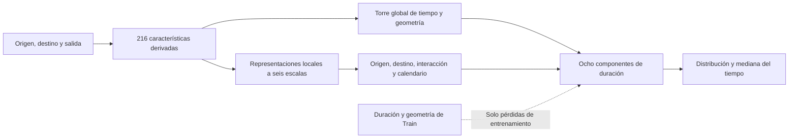

> **Cierre del 23 de noviembre:** la última propuesta terminó y la investigación quedó cerrada.
> Mejor MAE primario: 129,990034 s; meta de 73,5 s no alcanzada; Test sin evaluar.
> Ver [cierre final](../revision_tesis/CIERRE_FINAL.md). Los planes y estados siguientes son históricos.

<!-- estado_actual_verificado_inicio -->
Mínimo numérico vigente: **MAE 129,990034 s**, en los mismos 127.941 viajes de validación. Corresponde a la atención sobre subtrayectos, época final fija 6. Se recargaron sus pesos y reprodujeron todos los cuantiles, más 65 consultas crudas con inversión de orden y caso individual.

Frente al padre de 130,158042 s, la diferencia es −0,168007 s, con intervalo exploratorio por día [−0,222310; −0,110332]. Es una mejora pequeña; RMSE empeora ligeramente y no se cumple el criterio predeclarado de mejora práctica de 0,5 s. La búsqueda adaptativa y el uso repetido de Validation impiden considerarla confirmación.

**La meta de confirmación <73,5 s sigue pendiente. Test está cerrado.** La cohorte publicada de TransferTraj es distinta de la local. Se conservan todos los resultados, incluidos los superiores a 131,06 s, las comparaciones TransferTraj y 43 checkpoints neuronales que cumplen el umbral de conservación. También se protege la fórmula no paramétrica de 130,959974 s con sus fuentes.

El ensayo conjunto de 24 épocas terminó en 130,685980 s. La corrección aislada del prior geométrico, con las mismas 34 variables e inicialización y seis épocas fijas, terminó en 129,994490 s: no supera el mínimo de 129,990034 s. Ambos checkpoints cumplen el umbral de conservación y pasaron reproducción completa. El estado del proceso está en replanteamiento_20261121/CONTINUIDAD_OPERATIVA.json; el mejor y sus dependencias, en nuevo_mejor_verificado.json; la receta vigente, en REPRODUCIR.md. La última revisión de conservación registró 16,71 GiB.

Los resultados históricos siguientes conservan su contexto; las cifras de cohortes internas o con trayectoria real no cuentan como MAE OD primario.
<!-- estado_actual_verificado_fin -->

# Resumen de resultados conservados

La meta MAE de confirmación <73,5 s todavía no se ha alcanzado. Test permanece cerrado y el trabajo continúa; el estado vigente está en el apartado de replanteamiento continuo.

| Referencia | Validación: MAE (s) | Viajes |
|---|---:|---:|
| Original corregido | 140,822594 | 127.941 |
| Referencia conservada antes de esta reanudación | 131,256712 | 127.941 |

La mejora frente al original corregido fue de 9,565882 s, aproximadamente 6,8 %. El modelo de referencia de 131,256712 s tiene 4.280.768 parámetros y 216 características derivadas de origen, destino y salida. El checkpoint se seleccionó en la época 53; su evaluación conservada usa float32 y lote canónico 2.048. Se conservaron pesos, fuentes congeladas, selección, historial, predicciones y recursos para entrenamiento e inferencia.

En el ciclo histórico previo a la reanudación, las iteraciones posteriores no justificaron aumentar el costo de aquellos mecanismos. En la reserva interna reutilizada de 4.096 viajes, ocho bancos obtuvieron 130,555825 s frente a 131,286107 s del control: mejora de 0,730283 s, inferior al mínimo fijado y con intervalo que incluía cero. Es una muestra distinta de la validación primaria. El modelo pesado TabFM y sus correcciones no superaron el control en sus pruebas internas. Las últimas anotaciones/cabezas se interrumpieron: no se les atribuye un resultado predictivo.

Las búsquedas fueron adaptativas. Los intervalos internos no corrigen toda esa selección. Ni las pruebas privilegiadas con trayectoria observada ni las corridas incompletas cuentan para la meta OD.

[TransferTraj: métricas y predicciones conservadas](comparaciones_transfertraj/README.md). El archivo identifica siete modelos OD de esa familia, dos controles con representaciones y un intento incompleto. La cohorte publicada de TransferTraj no estaba disponible: estas cifras corresponden al protocolo local, no al 1,225 min reportado en su benchmark.

Los resultados tabulados completos están en `resultados/resultados_experimentos.csv` y su JSON. Se distingue la elegibilidad según la auditoría original y los diagnósticos privilegiados. `resultados/resultados_internos.json` separa los estudios internos. El archivo `resultados/historial_evidencia.zip` conserva, sin duplicados de contenido, código y evidencia ligera; no conserva los tensores ni modelos descartados.

[Cómo reproducir el modelo](REPRODUCIR.md). Las verificaciones antes/después de la limpieza y el inventario están en `../auditoria/limpieza/`.

La limpieza redujo el proyecto de 74.49 a 13.85 GiB (reducción aproximada de 60.64 GiB, 81.4 %). Los 407 archivos protegidos conservaron sus huellas. La verificación posterior reprodujo exactamente las 127.941 predicciones y las consultas crudas. Detalle: `../auditoria/limpieza/resumen_limpieza.json`.

<!-- operativo_20261121 -->
## Reanudacion operativa del 21 de noviembre de 2026

Se ejecutaron siete entrenamientos o ajustes y una simulacion causal con cuatro variantes. La meta <73,5 s sigue sin alcanzarse. El modelo conjunto con rutas globales entrenado desde cero termino tras 63 epocas; su mejor estado obtuvo 131,399512 s en float32, frente a 131,256712 s del conservado. La diferencia pareada fue +0,142800 s, IC95% por dia [-0,083745; 0,355441]: no justifico sustituir el modelo.

La transferencia regional selectiva no supero el control. El ajuste directo al MAE y los adaptadores de distribucion tampoco mejoraron el original. El estado causal local alcanzo 130,418913 s bajo un protocolo online distinto, con viajes ya completados y demora de publicacion de 60 s; no certifica la meta del benchmark estatico.

Una cota diagnostica de 123,835791 s descarta alcanzar la meta mediante mezclas convexas de los dos modelos fijos evaluados, incluso con seleccion privilegiada. No se generaliza a otros modelos ni al error irreducible.

Se conservaron historias, configuraciones, codigo y predicciones distintas; se eliminaron 106.626.152 bytes de pesos, caches de rutas y duplicados descartados. El modelo original y los diez archivos de predicciones TransferTraj conservan sus huellas. La verificacion final reprodujo exactamente todas las predicciones del modelo principal y las consultas OD crudas. Al cerrar aquel ciclo no había experimentos activos; la reanudación vigente se describe abajo. Test permanece cerrado.

[Resultados y limites del ciclo](desarrollo_20261121/README.md). [Registro estructurado](desarrollo_20261121/resumen_resultados.json).

<!-- replanteamiento_activo_20261121 -->
## Replanteamiento continuo activo

El objetivo de confirmación <73,5 s permanece activo. Test sigue cerrado. La mejor referencia conservada continúa en 131,256712 s. Por indicación del usuario, los nuevos candidatos con MAE de Validación completa <131,06 s conservarán pesos, métricas, predicciones y reproducción; se protegen también el modelo anterior y todos los resultados TransferTraj.

| Mecanismo evaluado | MAE en los mismos 127.941 viajes |
|---|---:|
| Descomposición movimiento/bajo desplazamiento supervisado | 131,627313 s |
| Control con la misma descomposición, sin supervisión del conteo | 131,417567 s |
| Memoria de etiquetas con métrica entrenable, distribución | 137,431590 s |
| Memoria de etiquetas con métrica entrenable, media/MSE | 144,303155 s |
| Proceso espacial semi-Markov sin dirección | 138,223439 s |
| Memoria de residuos fuera de bloque | 136,305803 s |
| Proceso espacial con dirección | 137,918025 s |
| Dirección y prior de conteos | 137,538866 s |
| Permanencias por fases y referencia fuerte | 132,700776 s |

No mejoran la referencia. La supervisión de bajo desplazamiento empeora 0,2097 s respecto a su control en esta configuración (IC95 % exploratorio por día: 0,0442 a 0,3703 s); no se generaliza ese resultado a todas las formas de modelar paradas.

La memoria de residuos tampoco mejoró su base (136,186084 s). Ambas variantes terminaron sin mejorar la referencia. La corrección física con permanencias por fases terminó 6.000 actualizaciones, con 96.000 consultas para el tiempo total y 384.000 estados locales. Obtuvo 132,700776 s, peor que la referencia en 1,444064 s (IC95 % exploratorio por día: 1,236382 a 1,665372 s). La rama espacial obtuvo 141,159167 s: mejoró dentro de su familia, pero sigue por encima de la referencia. Se reprodujeron exactamente las 127.941 predicciones de referencia antes del ajuste; las distribuciones se mantienen solo en RAM. La calibración única declarada de antemano terminó: el peso elegido de 0,02 obtuvo 131,257416 s; ninguno de los ocho pesos mejoró la referencia. No se repetirán búsquedas de pesos para esa rama congelada.

Se conservan predicciones y fuentes de ensayos descartados, retirando sus pesos. No se generan bancos CDF por viaje en disco. [Propuesta, conclusiones y ejecución](replanteamiento_20261121/README.md); [política de conservación](replanteamiento_20261121/politica_conservacion.json).

<!-- transicion_prefijo_nativo -->
El piloto de contexto compartido por viaje no justificó un entrenamiento completo: la diferencia de NLL frente a un contexto independiente por tramo fue +0,000183 por observación (IC95 % por día: −0,000264 a +0,000635), en semanas de Train reservadas solo para esos nuevos parámetros escalares. No es una prueba de independencia general. La siguiente alternativa es un generador recurrente de zona, permanencia y finalización a intervalos nativos de 15 s. En consulta usará únicamente su propia trayectoria generada y un horizonte fijo de 120 pasos, sin conocer la longitud real. Pasó pruebas de causalidad, gradientes, conservación de probabilidades y reconstrucción exacta de 1.000 viajes de Train. Todavía no tiene un MAE. El entrenamiento recurrente terminó diez épocas y se encuentra en evaluación completa.

El estado vigente de las ejecuciones está en pipeline_prefijo_estado.json y CONTINUIDAD_OPERATIVA.json, dentro de replanteamiento_20261121. Las métricas parciales o de selección no sustituyen los 127.941 viajes de Validación.

<!-- calibracion_completa_prefijo_activo -->
La calibración terminó con MAE 131,257416 s para el peso elegido, frente a 131,256712 s de referencia. No hay candidato nuevo <131,06 s. El generador de prefijos terminó diez épocas; la evaluación completa sigue activa. Pasó gradientes finitos con datos reales de Train en GPU y reprodujo exactamente las 127.941 predicciones de referencia. Todavía no hay MAE completo del generador.

El inventario tras retirar la reanudación terminada fue 13,9553 GiB. El mejor modelo y los diez archivos de predicciones TransferTraj conservaron sus huellas. Ver inventario_conservacion.json; el tamaño puede crecer temporalmente con el punto de reanudación del entrenamiento activo.

<!-- diagnostico_historia_Train -->
El diagnóstico de historial temporal encontró una mejora local en 9.198.270 decisiones reservadas de Train: NLL 0,558328 → 0,541826, con intervalo por día de la diferencia por debajo de cero. Todavía no demuestra mejora del MAE del viaje ni información adicional frente al modelo neuronal. Antes de otra corrida GPU se compararán cabezas equivalentes con/sin historial y el modelo neuronal original, sobre el padre congelado y sin usar GPS de Validación o Test. El estado vigente sigue en los registros de ejecución.

<!-- control_riesgo_total_preparado -->
Quedó preparado un objetivo distinto sobre el tiempo total de trayectorias generadas. Su estimador pasó enumeración exacta, un muestreador sintético y gradientes con cuatro consultas reales de Train, sin actualizar pesos. El ensayo requiere después una prueba GPU y validación completa; estos instrumentos no demuestran una mejora de MAE. La ejecución seguirá secuencialmente tras los controles en curso y conservará cualquier candidato <131,06 s, además del mejor modelo en todo caso.

<!-- cierre_nativo_riesgo_activo_20261122 -->
## Resultado completo y ensayo vigente

El generador nativo terminó: 79.960 actualizaciones y evaluación de los mismos 127.941 viajes. Los MAE para pesos 0; 0,05; 0,2; 0,5; 1 fueron 131,256712; 131,339954; 131,947030; 135,526180; 148,755950 s. Ninguna salida mejora la referencia. El peso elegido es cero y reproduce exactamente la referencia; no representa una mejora aprendida. Incluso la diferencia de +0,083241 s del peso 0,05 tiene IC95 % exploratorio por día [0,006151; 0,167739]. Ver conclusion_nativo_completa.json.

El control de historial temporal también terminó. Sobre el estado neuronal congelado, la cabeza con conteos empeoró NLL respecto a la cabeza equivalente sin conteos en 0,015864 [0,014052; 0,017760]. Se descartó esa corrida GPU. La mejora previa frente a conteos más simples no demostraba complementariedad con la red. Se conservan las pruebas y conteos compactos; se retiraron 38,54 MiB de intermediarios terminados o descartados, manteniendo el padre recurrente necesario para el ensayo activo.

Está ejecutándose riesgo_total_s0: ajuste del CRPS del tiempo total de trayectorias completas generadas, con regularización por prefijos reales de Train. La comprobación GPU de gradientes finitos y no nulos pasó. Usa el padre nativo, sin la rama temporal descartada. Las pérdidas parciales no son un MAE de Validación. Ver pipeline_riesgo_estado.json y riesgo_total_s0.log para el avance efectivo.

Un diagnóstico distinto, solo con Train, predijo el tipo de llamada A/B/C desde OD y calendario con exactitud 82,18 % frente a 51,04 % de mayoría. Es una posible etiqueta auxiliar de entrenamiento, no un resultado de duración ni evidencia de información adicional frente a la red fuerte. El tipo observado no podrá entrar en consultas; cualquier propuesta deberá inferirlo y marginalizarlo usando únicamente los cinco campos autorizados.

La meta de confirmación <73,5 s sigue pendiente y Test permanece cerrado. La mejor referencia continúa en 131,256712 s. Se conservará todo candidato completo <131,06 s y cualquier nuevo mejor modelo, junto con métricas, predicciones, fuentes y reproducción. Estos resultados sustituyen los estados pendientes de los apartados históricos anteriores.

<!-- tipo_latente_control_20261122 -->
El instrumento semántico con representación fuerte congelada terminó: en 5.475 filas reservadas de Train, el control equivalente obtuvo MAE 110,991 s y la supervisión del tipo 110,274 s; diferencia -0,718 s, IC95 % exploratorio por día [-1,370; -0,037]. La referencia obtuvo 112,748 s en esa muestra. La NLL de duración también bajó de 3,48855 a 3,48186. El intervalo se refiere a Train, no a Validación. La representación de base ya había visto estas filas, por lo que no constituye generalización independiente.

Está en marcha un control ampliado solo en CPU: encoder de referencia congelado, tres expertos semánticos de duración mediante inclinación suave de su distribución y compuerta inferida desde la representación OD. El tipo A/B/C es exclusivamente una etiqueta de Train. Se ajustan una cabeza supervisada y un control de capacidad equivalente sin esa etiqueta, con presupuesto fijo y sin seleccionar durante entrenamiento en Validación. Al finalizar se evaluarán todos los 127.941 viajes. Las representaciones y distribuciones se mantienen solo en RAM, sin bancos en disco. Ver tipo_latente_cpu_s0/plan.json y su registro. Continúa a la vez un único trabajo GPU: riesgo_total_s0.

<!-- cierre_tipo_latente_y_aux_conjunta -->
La evaluación completa de cabezas congeladas terminó. Control sin etiqueta: MAE 135,105752 s; tipo supervisado: 134,787793 s. La etiqueta mejora su control en 0,317959 s [IC95 % exploratorio por día: -0,419840; -0,219175], pero empeora la referencia en 3,531081 s [2,517468; 4,630605]. Ningún candidato nuevo. La referencia CPU reprodujo exactamente todas las predicciones protegidas; también pasaron orden inverso y consultas individuales. No se ajustarán más mezclas para estas dos salidas.

La señal pequeña a favor de la etiqueta motiva un ensayo distinto: aprender p(T,c|OD) con el tipo como pérdida auxiliar condicional sobre los ocho componentes originales, manteniendo su marginal de duración, su objetivo primario y su supervisión geométrica. Al consultar se suma sobre el tipo; la llamada real no es entrada. Este ensayo no depende de una corrección ajustada a errores internos de la referencia. La prueba CPU de factorizar/marginalizar y transmitir gradientes pasó, sin actualizar pesos. Es una hipótesis aún sin MAE.

Se prepararon cuatro épocas fijas con/sin esa pérdida, con prueba GPU inicial obligatoria y una única GPU. Se espera el resultado y la salida real del ensayo de riesgo; cualquier mejora suya tendrá prioridad para reproducción. Ver plan_aux_solicitud.json y pipeline_aux_solicitud_estado.json. El objetivo <73,5 s permanece activo y Test cerrado.

<!-- maestro_probabilistico_Train_y_alumno_OD -->
Se completó un instrumento probabilístico distinto, sin representación compartida preentrenada ni uso de Validación/Test. En 43.591 viajes reservados de Train, el maestro solo OD obtuvo MAE 144,3174 s; añadir geometría observada de Train dio 110,7896 s. La NLL bajó 3,86640 → 3,61070 y el CRPS 106,5536 → 80,5827 s; ambos intervalos exploratorios por día excluyeron cero. La cobertura del intervalo del 80 % fue 80,97 %. Es un maestro privilegiado, no una solución OD ni una cota del error posible.

Se está creando un maestro cruzado completo con cinco modelos: cada fila de Train se predice excluyendo su bloque semanal completo del ajuste del maestro. Usa únicamente variables deterministas y geometría de esa fila como información privilegiada de Train; no usa número de puntos ni velocidad máxima GPS. Se guardan dos parámetros probabilísticos por fila, no bancos CDF. No se altera ninguna etiqueta original ni la cohorte de Validación.

El alumno OD preparado añade una pérdida suave que coincide, en gradiente, con el NLL+5RPS esperado bajo el maestro. La prueba exacta de valor/gradiente y una prueba con datos reales de Train pasaron en CPU, sin actualizar pesos. La trayectoria observada no entra en el forward del alumno. Se mantendrán cuatro épocas, objetivos primarios/geometría y el control ya predeclarado, cuya función primaria y muestreo son literalmente iguales. Se requiere una comprobación GPU inicial antes de aprender.

El alumno se encadena detrás del ensayo de solicitudes y del maestro CPU, respetando una GPU. Un candidato previo que ya alcance la meta tiene prioridad para reproducción/congelación/confirmación. Estos trabajos aún no tienen un MAE OD nuevo. Ver plan_alumno_maestro.json, verificacion_perdida_maestro.json, maestro_cruzado_s0 y pipeline_alumno_estado.json.

<!-- cierre_riesgo_y_recuperacion_GPU_v2 -->
El ensayo de riesgo de viaje completo terminó 3.174 actualizaciones (50.784 consultas), con checkpoint elegido en 3.000. Para pesos 0; 0,05; 0,2; 0,5; 1, los MAE completos fueron 131,256712; 131,308533; 131,769878; 134,244613; 142,366521 s. Ninguno mejora la referencia. El peso elegido en512 fue0,05: empeora en0,051821 s, IC95 % exploratorio por día [0,009255;0,095521]. No se amplía esta misma configuración solo para perseguir la cifra. No demuestra imposibilidad de todos los generativos.

El maestro cruzado completo terminó para1.023.485 filas, cada una predicha una sola vez sin ajustar su bloque semanal. Los parámetros comprimidos ocupan12.832.010 bytes. Su cobertura80 fue83,75 % sobre Train fuera de ajuste. Es supervisión privilegiada de Train, no un MAE OD. Se retiraron pesos generativos descartados y maestros piloto superados; se conservan todas sus predicciones, métricas y fuentes y los cinco maestros completos necesarios para el alumno.

El primer control auxiliar no actualizó pesos: falló al exigir un acumulado CUDA estrictamente determinista no implementado en esta instalación. Las fuentes y el fallo están archivados. La versiónv2 restablece el cálculo CUDA habitual con semillas fijas, sin cambiar pérdidas, etiquetas ni muestras. Su prueba GPU inicial pasó y reprodujo exactamente todas las predicciones de referencia antes de aprender. El control y la supervisión semántica mantienen cuatro épocas; el alumno de objetivos suaves espera su turno y usa exactamente el mismo control/objetivo primario/muestreo.

Estado vigente: pipeline_aux_solicitud_estado.json, pipeline_alumno_estado.json y CONTINUIDAD_OPERATIVA.json. Los identificadores antiguos de procesos no indican trabajos activos. Objetivo73,5 s pendiente; Test cerrado.

<!-- campo_multiescala_desde_cero -->
## Nueva representación espacial y aprendizaje desde cero

Las últimas pruebas terminaron sin mejora. En época4: control131,396816 s; solicitud auxiliar131,486388 s; alumno de maestro probabilístico131,526133 s. La solicitud empeora su control en0,089573 s [0,042085;0,137523] y el alumno en0,129317 s [0,034317;0,223687], intervalos exploratorios por día. Ambos seleccionaron época0 (referencia), sin avance aprendido. La integración de cinco históricos obtuvo131,306891 s; aplicar el bloque semanal correspondiente131,345229 s. Sus controles reprodujeron la referencia. No se seguirán ajustando esas salidas congeladas.

El cambio siguiente afecta la representación y el aprendizaje completo: seis rejillas continuas para origen y seis para destino, con pasos de1.000 a31,25m. La interpolación bilineal combina ocho canales por escala. Se concatenan los dos extremos, su producto y ocho variables de calendario; una proyección de128 unidades modifica los parámetros de los ocho componentes de tiempo/geometría del modelo global. Se aprenden desde cero tanto la torre global como las rejillas. La confianza de cada nodo usa solo frecuencias de coordenadas de Train, n/(n+20), para reducir el efecto de celdas sin apoyo.

La prueba CPU pasó interpolación, invariancia de orden, recuperación exacta al anular la rama nueva y gradientes finitos. La prueba GPU real también pasó, reproduciendo todas las predicciones protegidas antes de aprender. Los embeddings recibieron gradientes no nulos en el entrenamiento. El modelo tiene6.340.040 parámetros. Presupuesto fijado: hasta50épocas, parada por paciencia después de20, máximo una hora por brazo. Si supera la referencia se ejecutará un control denso de capacidad comparable con igual inicialización global, datos, objetivo y semillas; si no, se evita ese gasto adicional.

[ODConNet](https://openreview.net/pdf?id=y9tJg8Me65), manuscrito rotulado en revisión paraICLR2026, motiva conceptualmente el uso de varias escalas; no se establece aquí su aceptación final ni se afirma replicarlo. [MDTI](https://arxiv.org/html/2510.05840v1) es un antecedente multimodal de2025 que utiliza trayectorias completas; sus resultados no sustituyen la evaluación OD. La implementación local no recibe la trayectoria real en consulta.

Ver plan_campos_multiescala.json, pipeline_campos_estado.json y campo_multiescala_s0.log. El objetivo de confirmación73,5 s sigue pendiente; Test permanece cerrado.

<!-- cierre_campo_y_subviajes_supervisados_20261122 -->
## Cierre del campo espacial y siguiente supervisión

El campo multiescala terminó20épocas: su mejor resultado fue135,423828s en época4. Después la pérdida de Train siguió bajando mientras la validación empeoró, hasta150,197318s en época20. Esta configuración sobreajusta y no supera la referencia131,256712s. El control adicional de capacidad se omitió según la regla fijada. Se conservan sus métricas y todas las predicciones por época; sus pesos temporales descartados se retiraron.

La siguiente prueba añade una tarea supervisada con tiempos de subtrayectos exclusivamente de Train:250.000 viajes elegidos con semilla fija produjeron475.076 ejemplos. Para observaciones i,j, la etiqueta es15*(j-i)s y la salida es la fecha del viaje más15*i. Las entradas siguen siendo únicamente origen, destino y fecha de salida. La procedencia, los índices de observación y la trayectoria no entran al modelo. No se cambian filtros ni etiquetas de la cohorte primaria.

Se usa el codificador del mejor modelo con dos salidas de duración: la original para viajes completos y otra para subtrayectos, con ocho componentes y parámetros independientes por miembro. La salida auxiliar evita exigir que los subtrayectos tengan el mismo tiempo de espera que los viajes completos. Primero se ajusta esa salida con el codificador congelado durante una época; después se entrenan seis épocas conjuntas, peso auxiliar0,2, tasa1e-5 para el modelo original y0,001 para la salida auxiliar. Solo si aparece una mejora se ejecutará el control equivalente con peso auxiliar cero.

Cada viaje padre llega antes del primer viaje de validación. Los padres que cruzan una semana UTC se excluyen solo de la tarea auxiliar: así se puede excluir su semana completa de todos los niveles de históricos de su propia consulta. Los cinco datos de entrada reconstruyeron exactamente las216características para65viajes de Train antes de crear el conjunto auxiliar. Las10000pruebas de intervalos y el rechazo de campos de procedencia pasaron. El entrenamiento debe superar además la prueba de gradientes y reproducir la referencia antes y después del calentamiento.

La preparación conserva consultas, etiquetas y procedencia en11.116.354bytes. El caché de características tiene un límite de600MiB y se retirará si el ensayo terminado no mejora; se conserva el procedimiento para reconstruirlo. Se guardan métricas y predicciones de **todos** los experimentos, incluso con MAE mayor de131,06s. Los pesos del mejor modelo y los candidatos por debajo de131,06s permanecen protegidos. Los resultados TransferTraj y los datos originales también.

Ver plan_aux_subviajes.json, pipeline_subviajes_estado.json y conclusion_aux_subviajes.json cuando exista. Estado todavía exploratorio: objetivo73,5s pendiente y Test cerrado.

<!-- cierre_subviajes_y_atencion_vial -->
El ensayo auxiliar de subtrayectos concluyó las seis épocas. Los MAE aprendidos fueron131,370085;131,369967;131,369264;131,397519;131,359885;131,362933s. Ninguno mejora131,256712s; la época0 seleccionada sigue siendo la referencia, sin avance aprendido. La época6 empeora en0,106221s, IC95% exploratorio por día[0,004467;0,212297]. El control condicional no se ejecutó. Se mantienen las seis predicciones y métricas, las consultas/etiquetas/procedencia auxiliares y sus fuentes. Se retiró únicamente el caché de características206.299.998bytes; reconstruir_features_subviajes.py permite regenerarlo.

La siguiente alternativa aporta composición vial ordenada: dos rutas generadas con el mapa público2014, elegidas exactamente como las rutas longitud/tiempo libre del modelo protegido, se resumen con32identificadores de tramo equidistantes por ruta. La consulta conserva solo origen,destino,fecha. No recibe trayectoria observada, cantidad de puntos ni duración. Se mantuvieron todos los viajes de Train y validación; la preparación no leyó etiquetas de validación. La comprobación de65consultas de Train recuperó longitudes y tiempos libres con error máximo0.00000000, y pasó orden inverso, consultas individuales y rechazo de trayectoria adicional. El caché comprimido ocupa101.21MiB.

Se evaluará atención sobre estos tramos: embeddings16dim, seis variables geométricas de mapa y ocho de calendario; Transformer64dim,dos capas,cuatro cabezas, y corrección de24parámetros de tiempo de los ocho componentes. La salida correctora empieza en cero. Se fijan tres épocas con la torre global congelada y seis conjuntas. Es una arquitectura local inspirada en el modelado de composición y secuencias, no una réplica de UNITE. Solo una mejora real justifica ejecutar la ablación que elimina la información de los tramos y conserva calendario/código; no se la presentará como igualdad de capacidad efectiva.

Todas las métricas y predicciones se conservan, incluso por encima de131,06s. El objetivo73,5s sigue pendiente; Test permanece cerrado.

<!-- cierre_atencion_y_diagnostico_proyeccion -->
La atención sobre dos rutas públicas terminó las nueve épocas previstas: mejor época aprendida4, MAE131.273829s, frente a131,256712s. La época9 obtuvo132,545431s; su empeoramiento frente a la referencia es1.288719s. La época0 seleccionada es el modelo original; no se presenta como ganancia aprendida. El descenso de pérdida Train durante las épocas conjuntas no se trasladó a validación. No se ejecutó la ablación condicional porque no hubo mejora.

Se conservaron las nueve predicciones y métricas, con todos sus viajes y etiquetas comprobados. Se retiraron106,124,482bytes de cachés de rutas descartados. Se mantienen fuentes, frecuencias ajustadas solo enTrain, manifiestos y el instrumento reconstruir_secuencias_viales_od.py, que regenera los cachés desde las consultas originales y comprueba sus hashes.

Antes de otro modelo GPU se medirá en20000viajes deTrain si varias conexiones plausibles de los extremos al mapa añaden cobertura útil. Se comparan las dos rutas protegidas y una recta contra esas mismas opciones más seis rutas por otras tres parejas de proyecciones. Las nuevas parejas se eligen por distancia GPS, sin etiquetas. La geometría real se usa solo para medir un selector oráculo: no es una predicción OD desplegable ni un resultado deMAE. Umbral fijado antes del piloto: reducción media geométrica de al menos2% y5m. Un fallo de compilación deNumba anterior a cualquier resultado se archivó y se corrigió sin cambiar datos, matemáticas ni umbral.

El objetivo73,5s sigue pendiente. Se conservan métricas/predicciones incluso cuando superan131,06s, el mejor modelo y los resultadosTransferTraj; Test cerrado.

<!-- mezcla_incertidumbre_proyeccion -->
## Incertidumbre en la conexión al mapa

El piloto exclusivamente deTrain pasó el umbral fijado: en20000viajes, elegir con la geometría real entre las dos rutas protegidas y una recta da269,062286m de error medio; ampliar a ocho rutas más la recta baja a248,993851m. La diferencia20,068462m(7,46%) justifica ensayar más hipótesis. Un20,075% mejora más de10m. Es un selector oráculo para medir cobertura geométrica: no es un resultado deMAE ni una predicción disponible en consulta.

La arquitectura conserva los ocho componentes originales para cubrir rutas no representadas y añade ocho componentes de tiempo/geometría con una cabeza compartida. Dos hipótesis son las originales por longitud/tiempo libre. Las otras seis combinan ambos costes para tres parejas adicionales de proyecciones de origen/destino, elegidas por residuo GPS sin etiquetas. Una red compartida545-128-128-31recibe el estado global y las características de cada ruta; una puerta574-64-1usa el estado y los resúmenes del conjunto. La prioridad GPS usa30m, igual que el ajustador de mapa deTrain. La puerta empieza con logit-4: la nueva mezcla inicial tiene aproximadamente1,8%de masa candidata y no se confunde con la referencia original.

~~~mermaid
flowchart LR
 Q["Origen, destino y salida"] --> X["216 características originales"]
 Q --> R["8 rutas públicas con conexiones plausibles"]
 X --> B["Torre global protegida y 8 modos originales"]
 B --> H["Estado global compartido"]
 R --> C["Cabeza compartida de tiempo y geometría"]
 H --> C
 H --> G["Puerta según estado e incertidumbre del conjunto"]
 R --> G
 B --> M["Mezcla de 16 componentes"]
 C --> M
 G --> M
 M --> P["Distribución y mediana del tiempo"]
 T["Duración y geometría reales de Train"] -. "Solo pérdidas de entrenamiento" .-> M
~~~

La preparación retuvo todos los viajes originales y no leyó etiquetas devalidación. El nuevo banco ocupa362,75MiB. Solo sus entradas adicionales se almacenan enFP16 y se convierten aFP32; se mantienen las216entradas originales y las etiquetas. Media/desviación de rutas se ajustaron con las1.023.485filas elegibles deTrain antes de procesarvalidación. Los históricos excluyen la semana de cada consultaTrain a todos los niveles; para consultasholdoutsolo usanTrain.

Los instrumentosCPU comprobaron probabilidades normalizadas, recuperación del modelo original al quitar todas las rutas, gradientes finitos, invariancia del conjunto al permutar hipótesis del mismo tipo y ausencia de acceso a las rutas adicionales en el control de dos hipótesis. El instrumentoGPU reprodujo exactamente las127.941predicciones originales por el camino base y validó la pérdida conjunta con16componentes; el error máximo de normalización de responsabilidades fue3,58e-7. Desde65consultas con solo cinco campos se reconstruyeron exactamente las216entradas originales y el banco canónico; pasaron orden inverso, consulta individual y rechazo de trayectoria, cantidad de puntos, duración, tipo y procedencia.

Se fijaron tres épocas con la torre base congelada y seis conjuntas, con pérdidas originalesNLL+5RPS+0,2geometría. Solo si hay una reducción respecto de131,256712s se ejecutará el control con las dos rutas originales, conservando arquitectura, inicialización, normalización, muestreo y entrenamiento. Se mantiene la distinción entre una nueva función inicialmente distinta y una mejora aprendida. Guardar un candidato no acredita confirmación ni cercanía a73,5s.

Estado vivo: mezcla_proyeccion_incierta_s0.log y CONTINUIDAD_OPERATIVA.json. Todas las métricas/predicciones se conservan, también por encima de131,06s. Los pesos de todo nuevo mejor resultado y de cada candidato menor de131,06s quedan protegidos. Objetivo73,5s pendiente; Test cerrado.

<!-- historica_fresca_desde_cero -->
La mezcla de proyección quedó verificada en131,125167s(época6), frente a131,248505s de su control(época3). Al comparar la época9 fijada para ambos, la diferencia es-0,273759s. La diferencia seleccionada frente a la referencia original es-0,131545s, intervalo exploratorio por día[-0,194621;-0,074435]. Sigue siendo una mejora pequeña en validación reutilizada, con una sola semilla; no alcanza131,06s ni73,5s. Ambas reproducciones completas y las consultas crudas/independientes pasaron. Los cuatro mejores sucesivos del tratamiento y el control se conservan.

La siguiente propuesta incorpora seis prototipos de rutas reales de otras semanas como modos de geometría y tiempo. En el diagnóstico de20000viajesTrain, dos rutas públicas más seis prototipos redujeron el error geométrico oráculo a108,638779m frente a248,993851m de ocho rutas públicas:140,355057m(56,37%) con igual número de candidatos. La selección no recibe geometría ni duración reales de la consulta. Es evidencia de cobertura, no de rendimientoMAE.

El índice usa894105viajes elegibles deTrain con geometría válida y llegada anterior avalidación. Para cada consulta toma64vecinos por extremos, con pesos espaciales, horarios y tipo de día. Elige seis representantes geométricos y calcula medianas/MAD de tiempos históricos escalados por distanciaOD. Excluye toda la semana-grupo de la consultaTrain. Cambiar masivamente tiempos/geometrías de esa semana en memoria dejó las entradas idénticas. También pasaron reconstrucción desde cinco campos, orden inverso, consulta individual y rechazo de duración adicional. Los prototipos transformados son un prior geométrico latente; no se garantiza que sean rutas navegables.

El banco histórico y su memoria ocupan412,98MiB. Una advertencia de ajuste escalar detectada antes del entrenamiento se corrigió con cálculoTrain en64bits: pendiente0,776607e intercepto1,429573. Se conservan ambas versiones y la explicación; las características y las etiquetas originales permanecen.

Se entrena desde cero la arquitectura completa de22componentes: ocho modos generales, ocho alternativas públicas y seis prototipos históricos, con cabezas compartidas y puertas aprendidas. La puerta histórica empieza con masa0,5para permitir aprender de esa información desde el inicio. Solo se reutilizan estadísticas de entrada y calibraciones ajustadas enTrain; no se cargan pesos de la red anterior. Presupuesto fijado: hasta50épocas, mínimo20, paciencia12, una hora, unaGPU; si mejora131,125167s se ejecutará la ablación sin rama histórica.

El mejor modelo verificado anterior y los resultadosTransferTraj siguen protegidos. Se guardan todas las predicciones/métricas, y los pesos de cada nuevo mejor resultado y candidato menor de131,06s. Test permanece cerrado. Ver plan_historica_fresca.json, historica_fresca_s0.log y CONTINUIDAD_OPERATIVA.json.

### Corrección de posiciones y experimento recurrente en curso

Se verificaron 41.775.036 tokens auxiliares y se corrigió la interpretación de 680.543 posiciones internas no iniciales y 689.590 transiciones que no recorren una calle comprimida completa. Los tiempos originales y todos los viajes primarios se conservan. No se atribuye a esta corrección una mejora de MAE antes de medirla.

Se inició una alternativa con memoria del recorrido, cuatro estilos latentes y reloj previsto. Entrena seis épocas con 1.023.485 consultas primarias y secuencias auxiliares de 894.105 viajes. Las pruebas neuronales de llegada, inmovilización del estado al terminar, independencia por lote y reloj preciso pasaron. El lote de entrenamiento elegido usa unos 4 GB de memoria gráfica; el estado del modelo ocupa 8,55 MiB y excluye la matriz pública de distancias de 2 GB.

Después se generarán recorridos solo a partir de OD y fecha para comparar el modelo con un control de igual capacidad. No hay todavía un resultado de MAE de esta alternativa. Test permanece cerrado. Se conservan métricas y predicciones también cuando superan 131,06 s.

### Secuencias completas y reloj previsto (Porto OD)

Experimento de seis épocas con todos los viajes originales de Train; secuencias auxiliares corregidas, memoria recurrente y reloj previsto. Test cerrado.

| Modelo | MAE Validation (s) |
|---|---:|
| Raíz sin recorrido previsto (diagnóstico) | 137.894576 |
| control216_MAE | 135.988501 |
| full246_MAE | 136.111205 |
| full246_q10 | 187.840078 |
| full246_q50 | 136.075196 |
| full246_q90 | 254.613662 |

Resultado del criterio de mejora: False.
Se conservan todas las métricas y predicciones, incluso las que superan 131,06 s. Las calles y tiempos auxiliares son inferidos; este resultado no constituye una confirmación independiente ni una reproducción exacta de UNITE.
La meta de confirmación inferior a 73,5 s continúa pendiente.

### Consistencia del tiempo total por viaje

Dos épocas fijas entrenaron solamente 8.386 parámetros de corrección positiva de tiempos; el cuerpo neuronal y el predictor de rutas permanecieron congelados. Se conservan todos los viajes y tiempos primarios.

MAE Validation de la propuesta: 135.996132 s. Criterio de mejora útil: False.

El diagnóstico con recorrido conocido de Train pasó de 95.358349 a 76.288449 s; es una supervisión privada y no equivale al MAE OD. Las métricas y predicciones completas se conservan incluso por encima de 131,06 s. Test cerrado; objetivo de confirmación 73,5 s pendiente.

### Difusión conjunta global de tiempo y geometría

Modelo nuevo entrenado durante 30 épocas fijas con todos los tiempos originales; la geometría observada de Train es supervisión auxiliar. La consulta genera conjuntamente tiempo y geometría desde ruido, sin recibir recorrido real ni cantidad de puntos.

MAE Validation con 64 muestras y 32 pasos de denoising: 139.953394 s. Criterio de mejora útil: False.

Se conservaron todas las predicciones y métricas originales. Los candidatos elegibles incluyen reproducción desde cinco campos y sensibilidad a 256 muestras. Objetivo de confirmación 73,5 s pendiente; Test cerrado.

## Memoria de subtrayectos: combinación fija

La memoria directa obtuvo 163,945881 s; la combinación según evidencia obtuvo 130,959974 s en los mismos 127.941 viajes. Frente al mejor de 130,158042 s, la combinación empeoró 0,801932 s (IC exploratorio por día: [0,573310; 1,045564]). No pasó el criterio. Se guardan ambos resultados completos. La fórmula de 130,959974 s y sus dependencias quedan protegidas por estar por debajo de 131,06 s. Test cerrado.

Se prepara una rama aprendida con fuentes Train excluidas por grupo semanal, contexto de inicio/final de cada fuente y seis épocas fijas. El ensayo previo no autoriza barrer pesos o radios en Validation.

## Atención aprendida sobre subtrayectos: 129,990034 s

Tras seis épocas fijas con todos los viajes Train, el MAE bajó de 130,158042 a 129,990034 s: diferencia −0,168007 s, intervalo exploratorio por día [−0,222310; −0,110332]. RMSE 209,651248 s, mediana del error absoluto 75 s. La mejora en MAE es pequeña; RMSE empeora ligeramente y no se cumple la puerta de mejora práctica de 0,5 s. Se conserva como mínimo numérico verificado, sin afirmar confirmación ni ventaja causal del mecanismo.

Los pesos guardados se recargaron y reprodujeron todos los cuantiles de las 127.941 consultas, más 65 consultas crudas con inversión de orden y caso individual. La evaluación final se recuperó en un proceso que carga solo Validation tras superar el límite de memoria al conservar Train residente. Se verificó que los pesos coinciden con la recuperación de la época 6. No se repitió el entrenamiento.

El modelo, de 0,90 MiB como rama adicional, necesita el padre de atención histórica y su cadena protegida, la memoria de puntos y los índices compactos. Receta: replanteamiento_20261121/reproducir_atencion_subtrayectos.py. Test permanece cerrado.

## Instrumento Train: regímenes explícitos de duración

En la cohorte cronológica interna reutilizada de 40.000 consultas de ajuste y 10.000 reservadas, un bosque de distribuciones con puerta para T ≥ 900 s obtuvo 138,604500 s; su control global, 139,332000 s, y la referencia previa sobre esas mismas filas, 133,355393 s. La mejora de 0,727500 s frente al bosque global fue insuficiente y quedó 5,249107 s por detrás de la referencia. La puerta alcanzó AUC 0,830398. Se descarta esta implementación; no se barre el umbral ni se ejecuta una prueba primaria solo por el AUC. Métricas y predicciones conservadas. No se usaron Validation ni Test en este instrumento.

<!-- resultado_subtrayectos_conjuntos_s0 -->
## subtrayectos_conjuntos_s0

Estado final fijo de 24 épocas; 1.023.485 consultas Train por época y los mismos 127.941 viajes de Validation. MAE 130.685980 s; RMSE 208.880942 s. Criterio de mejora útil: no cumplido. Todos los tiempos y consultas originales se conservaron. Métricas, predicciones y fuentes completas guardadas; pesos protegidos por umbral o mínimo. Test cerrado.

<!-- resultado_prior_arco_subtrayectos_s0 -->
## Corrección del prior geométrico de subtrayectos

Se conservaron las 34 variables temporales, normalización, arquitectura, inicialización neuronal y seis épocas. Solo se corrigió la referencia geométrica auxiliar para usar posiciones por distancia de arco. MAE final: 129.994490 s sobre los mismos 127.941 viajes. Criterio práctico: no cumplido. Todas las predicciones y métricas quedan conservadas; Test cerrado.

<!-- resultado_landmarks_red_Train_v2_s0 -->
## Distancias dirigidas a referencias públicas: piloto cerrado

En una reserva cronológica reutilizada de Train de 10.000 consultas, las distancias a 32 referencias de la red obtuvieron 132,424078 s; el control con referencias euclidianas obtuvo 132,286900 s. La diferencia fue +0,137178 s, intervalo exploratorio por día [−0,399601; 0,661094]. No pasó el criterio predeclarado y no se escala a un experimento primario. Se conservan ambas predicciones, métricas, configuración, fuentes y verificaciones de consulta cruda. Estas cifras no corresponden a Validation primaria ni a Test.

<!-- hallazgo_busqueda_ordenada_Train -->
## Instrumento geométrico: búsqueda conjunta de fuentes

En 512 consultas Train reutilizadas, la búsqueda ordenada dentro de los padres descubiertos elevó de 67,7734 % a 98,8281 % la proporción con una fuente a menos de 100 m de error combinado. Se mantuvo la máscara geográfica y se comprobó el algoritmo por enumeración independiente. No es MAE ni confirmación. Se conservan las salidas y fuentes; ningún peso del mejor modelo cambió. El aumento del banco con 22.161.411 puntos adicionales no pasó su criterio de cobertura y no se guardó otro banco GPS.

<!-- resultado_transferencia_intervalos_Train_s0 -->
## Aumento de datos con transferencia de intervalos: cerrado

El piloto con 113.830 intervalos de los mismos 40.000 padres de ajuste obtuvo 133,785328 s en 10.000 consultas cronológicas Train. El modelo sin aumento obtuvo 133,511432 s y el control con tiempos artificiales 133,971355 s. La diferencia frente al modelo sin aumento fue +0,273897 s, intervalo exploratorio por día [−0,382703; 0,935985]. No pasó el criterio predeclarado. No se escala ni se buscan otros pesos o cantidades de intervalos; todas las predicciones, métricas, configuración y fuentes se conservan.

<!-- resultado_cdf_ordenada_Train_s0 -->
## Búsqueda conjunta: prueba temporal Train cerrada

Con las fuentes fuera de la semana de cada consulta Train, las distribuciones de tiempos históricos obtuvieron 130,955613 s en 10.000 viajes Train. El modelo público sin memoria obtuvo 133,121328 s y el control de igual dimensión con tiempos derivados de geometría 133,210289 s. Las diferencias fueron −2,165715 s frente al modelo sin memoria, intervalo exploratorio por día [−3,120481; −1,221083], y −2,254676 s frente al control, intervalo [−3,285641; −1,276916].

Existe señal temporal útil, pero no se cumplen los 5 s de mejora predeclarados para escalar este resumen a un experimento primario. No se cambia ese criterio ni se prueban nuevas cuadrículas o cantidades de fuentes. La cifra de 130,955613 s corresponde a Train reservado, no a los 127.941 viajes de Validation: no reemplaza al mejor modelo ni califica para conservar pesos por el umbral primario. Todas las predicciones, métricas, fuentes y referencias compactas se conservan. Test sigue cerrado.

<!-- resultado_mezcla_individual_Train_s0 -->
## Mezcla individual: piloto de 40.000 viajes cerrado

Tras 80 épocas fijas, los MAE de la reserva Train fueron 150,527837 s sin fuentes, 148,302471 s con el control geométrico y 145,292730 s con tiempos observados. La fuente temporal mejoró 5,24 s frente a la red sin fuentes y 3,01 s frente al control geométrico, pero empeoró 11,94 s frente a la referencia de árboles de 133,355393 s. No cumple el criterio de expansión.

La reproducción independiente coincidió en todos los cuantiles de los 10.000 viajes y en 65 consultas crudas. La mediana estable alteró el MAE menos de 0,000004 s; el problema numérico extremo no explica este fallo predictivo. Las grandes diferencias frente al error de ajuste son compatibles con sobreajuste y cambio temporal. Se conservaron las métricas y predicciones de ambas evaluaciones, las configuraciones, fuentes e historias; se retiraron solo los tres pesos transitorios descartados después de reproducirlos.

Se activa la comparación previamente definida con 951.718 viajes anteriores al mismo corte y cuatro épocas completas, aproximadamente el mismo presupuesto de actualizaciones. Mantiene los mismos 10.000 viajes de reserva, filtros y tiempos originales, y no modifica los campos de consulta. Test y la validación primaria siguen cerrados para esta familia.

<!-- resultado_mezcla_escala_Train_s0 -->
## Mezcla individual: comparacion con todo Train previo al corte

Con 951.718 viajes de ajuste y las mismas 10.000 consultas cronologicas de reserva, tras cuatro epocas completas fijas, los MAE fueron: none 130.029069 s, geometry 127.475221 s, observed 126.434575 s. El criterio temporal predeclarado no se cumplio.

Se reprodujeron independientemente los cuantiles de los 10.000 viajes de las tres versiones y 65 consultas de cinco campos, incluyendo orden inverso y consultas individuales. Se conservan todas las predicciones, metricas, configuraciones y fuentes, tambien cuando empeoran 131,06 s. Tras la reproduccion se retiraron solo los tres pesos transitorios y el indice de fuentes especifico de este piloto; su constructor y manifiesto permiten reconstruirlo.

Estas cifras corresponden a Train reservado, no a la validacion primaria de 127.941 viajes. El mejor MAE primario verificado sigue en 129,990034 s; el objetivo de confirmacion de 73,5 s sigue pendiente y Test cerrado.

<!-- resultado_puente_temporal_2d_Train_s0 -->
## Puente temporal bidimensional: comparación cerrada

En las mismas 10.000 consultas cronológicas Train, tras cuatro épocas sobre 951.718 viajes anteriores al corte, los MAE fueron 130,872000 s sin objetivos auxiliares, 129,616500 s con movimiento lineal y 130,152000 s con movimiento observado. El control lognormal con la misma inicialización de codificadores y regla probabilística obtuvo 129,622500 s. Ninguna de las dos hipótesis predeclaradas cumplió su criterio.

Se reprodujeron exactamente las probabilidades y los cuantiles de los cuatro modelos en los 10.000 viajes, además de 65 consultas públicas por reproducción, orden inverso y consultas individuales. No se necesitó el banco GPS original para inferir. Todas las métricas, predicciones, probabilidades, configuraciones y fuentes quedan conservadas. Se retiraron únicamente los tres pesos Student descartados; el control público queda como referencia de Train sin exposición a los viajes reservados.

La correlación de movimiento observada en ajuste no produjo por sí misma una ganancia útil en duración OD. La siguiente alternativa incorporará explícitamente estados de la red vial y espera, manteniendo el reloj original de 15 s y comprobándolo antes de construir datos grandes. El mejor resultado primario sigue en 129,990034 s; no se ha demostrado el objetivo de confirmación de 73,5 s. Test permanece cerrado.
