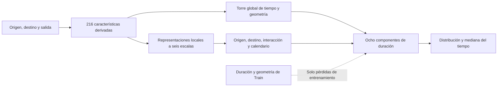

<!-- estado_actual_verificado_inicio -->
Mínimo numérico verificado: **MAE 130,158042 s** en los mismos 127.941 viajes de validación. La atención sobre historias individuales terminó ocho épocas y seleccionó la tercera; se reprodujeron todas sus predicciones y las consultas crudas, individuales y en distinto orden.

La diferencia frente al padre congelado de 130,204821 s es solo −0,046779 s, con IC95 % por día [−0,121414; 0,024939]. No pasó el umbral previo de mejora útil de 0,1 s y el intervalo incluye cero. Se conserva el mínimo observado, sin atribuirle una mejora fiable ni ejecutar el control condicional o seguir variando vecinos y pesos.

Se conservan 40 candidatos de estas últimas familias con MAE menor de 131,06 s y las métricas y predicciones de todos los ensayos, incluidos los peores y TransferTraj. El nuevo checkpoint guarda solo la rama de atención y requiere el padre protegido; la inferencia lo carga automáticamente. La mediana directa se descartó (mejor época aprendida: 131,355547 s). El control histórico certificado obtuvo 130,564166 s.

La meta de confirmación menor de 73,5 s sigue pendiente y Test cerrado. La cohorte publicada de TransferTraj es distinta. El siguiente estudio examina el mecanismo vial de UNITE y primero comprueba que no use ruta ni longitud reales en una consulta OD. Evidencia: nuevo_mejor_verificado.json, conclusion_atencion_historia.json, registro_consolidado_auditado.json y atencion_historia_individual_s0/certificacion/resultado.json.
<!-- estado_actual_verificado_fin -->

# Replanteamiento operativo activo

Objetivo: MAE de confirmación <73,5 s con la misma cohorte y consulta OD. Test sigue cerrado. Referencia conservada al inicio de esta etapa: 131,2567 s en Validación completa; el resultado vigente está al principio del documento.

## Resultados de esta etapa

- base_oof_estatica_s0: {"validation": {"n": 127941, "mae_s": 136.18608419982218, "rmse_s": 217.50664256249215, "mdae_s": 83.49401562688035}, "OOF": {"n": 1023485, "mae_s": 131.475149159145, "rmse_s": 212.84137741731294, "mdae_s": 80.09576416015625}, "in_sample": {"n": 1023485, "mae_s": 126.32435574647819, "rmse_s": 207.88454994783876, "mdae_s": 75.50473022460938}, "seconds": 1764.1730108261108}
- cabeza_fases_cpu: {"seconds": 16.26175308227539}
- datos_semi_markov: {"seconds": 123.99043798446655}
- descompuesto_aux0_s0: {"validation": {"n": 127941, "mae_s": 131.41756747250685, "rmse_s": 212.51456124532928, "mdae_s": 75.0}, "best_epoch": 48, "epochs_run": 68, "seconds": 3320.6846771240234}
- descompuesto_aux1_s0: {"validation": {"n": 127941, "mae_s": 131.62731258939667, "rmse_s": 212.15485612842585, "mdae_s": 75.0}, "best_epoch": 48, "epochs_run": 68, "seconds": 2367.459737062454}
- espacial_direccional_s0: {"validation": {"n": 127941, "mae_s": 137.91802471451686, "rmse_s": 217.45644950373136, "mdae_s": 90.0}, "od_validation": {"n": 127941, "mae_s": 138.0847421858513, "rmse_s": 218.18612603316336, "mdae_s": 90.0}, "graph_validation": {"n": 127941, "mae_s": 152.22395479166178, "rmse_s": 232.5844808193083, "mdae_s": 105.0}, "seconds": 1851.4751737117767}
- espacial_prior_cf_s0: {"validation": {"n": 127941, "mae_s": 137.53886557084905, "rmse_s": 216.9405669865068, "mdae_s": 90.0}, "od_validation": {"n": 127941, "mae_s": 138.09470771683823, "rmse_s": 218.09671610099505, "mdae_s": 90.0}, "graph_validation": {"n": 127941, "mae_s": 148.20280441766127, "rmse_s": 228.17326791366307, "mdae_s": 90.0}}
- espacial_semimarkov_s0_v2: {"validation": {"n": 127941, "mae_s": 138.22343892888128, "rmse_s": 220.15717408778448, "mdae_s": 90.0}, "od_validation": {"n": 127941, "mae_s": 138.33962529603488, "rmse_s": 220.7329296653693, "mdae_s": 90.0}, "graph_validation": {"n": 127941, "mae_s": 154.22175065069055, "rmse_s": 234.46667919909925, "mdae_s": 105.0}, "seconds": 1369.4464671611786}
- memoria_cdf_s0: {"validation": {"n": 127941, "mae_s": 137.4315895608132, "rmse_s": 219.76714831713943, "mdae_s": 90.0}, "best_epoch": 19, "epochs_run": 31, "seconds": 1326.5635328292847}
- memoria_mse_s0: {"validation": {"n": 127941, "mae_s": 144.3031549620929, "rmse_s": 215.5584713506147, "mdae_s": 98.6387939453125}, "best_epoch": 10, "epochs_run": 22, "seconds": 834.9217772483826}
- memoria_residual_oof_s0: {"validation": {"n": 127941, "mae_s": 136.30580321953553, "rmse_s": 216.76987131695302, "mdae_s": 84.3558398865672}, "best_epoch": 22, "epochs_run": 34, "seconds": 1050.101538658142}

## Conclusiones y siguientes pruebas

La memoria de duraciones sin base no mejora el modelo conservado. La variante de residuos fuera de bloque terminó en 136,3058 s, frente a 136,1861 s de su base; tampoco mejora en MAE. No se vuelve a ampliar esta variante sin una hipótesis adicional. Se prueba memoria de residuos calculados fuera de cada bloque; consultas y candidatos de entrenamiento pertenecen al mismo bloque excluido para impedir que la base transmita la etiqueta de consulta.
El proceso espacial sin dirección obtuvo 138,22 s en toda Validación. Su cabeza OD obtuvo 138,34 s y la rama espacial aislada con respaldo en consultas sin soporte, 154,22 s. Estas son comparaciones entre cabezas del mismo modelo, no una ablación con entrenamiento separado. La integración actual apenas aporta respecto a su propia cabeza directa y queda por encima de la referencia TabM.
En Train con semanas reservadas, añadir dirección entrante reduce NLL de siguiente zona de 0,77217 a 0,64690 y sube acierto de 72,75 % a 76,37 %. Esto justifica ampliar el estado, pero NO demuestra beneficio en MAE de duración. La nueva inferencia conserva dirección hipotética de cada transición; la dirección real de la consulta nunca se entrega. Se ejecuta también una corrección neuronal sobre un prior de conteos locales, excluyendo de esos conteos todo el bloque de la consulta Train; este prior no excluye el ajuste neuronal ni el grafo permitido entrenado con Train.
La descomposición liga tiempos de movimiento y bajo desplazamiento mediante convolución; el control sin esa supervisión terminó en 131,4176 s y el supervisado en 131,6273 s. El incremento de error supervisado es 0,2097 s, IC95 % exploratorio por día [0,0442; 0,3703]. Bajo desplazamiento es una aproximación GPS, no una etiqueta humana de parada.
Un selector con acceso a la verdad que eligiera entre las cinco salidas anteriores tendría 100,44 s. Es un diagnóstico privilegiado e inutilizable como predictor; limita solo la selección entre esas cinco salidas, no nuevas funciones ni otras arquitecturas.

## Ejecución vigente

El entrenamiento con permanencias por fases terminó en 132,700776 s de MAE en los 127.941 viajes; la rama espacial obtuvo 141,159167 s. La diferencia pareada del modelo integrado frente a la referencia fue +1,444064 s, IC95 % exploratorio por día [1,236382; 1,665372]. No mejora al modelo conservado.

La calibración única declarada en protocolo evalúa ocho pesos sin repetir la generación. Elegir el peso cero equivale al modelo anterior y no constituye un nuevo resultado aprendido. Las predicciones distintas y todas sus métricas se conservan.

El piloto CPU no respalda compartir un único efecto de demora por todo el viaje frente a un efecto independiente por tramo: diferencia de NLL +0,000183, IC95 % [−0,000264; +0,000635]. Por ello no se inicia un entrenamiento completo de esa hipótesis. Las pruebas sintéticas de ese instrumento sí pasaron; un instrumento correcto puede dar un resultado negativo en los datos.

La siguiente propuesta es un generador recurrente de celdas a la frecuencia nativa de 15 s. Aprende a desplazarse, permanecer y terminar con prefijos reales de Train. Al consultar, la historia y el tiempo transcurrido son los que el propio generador simula; nunca se le entrega la longitud o la trayectoria real. Se acumula probabilísticamente la finalización de 128 partículas en cada paso de un horizonte fijo de 120 pasos. La semilla depende solo de OD/salida, partícula y paso.

Las pruebas CPU pasaron: equivalencia de procesamiento secuencial y por lote, causalidad ante cambios del futuro, independencia del relleno, gradientes finitos, absorción conocida y conservación de masa. En 1.000 viajes reales de Train, duración y extremos coinciden exactamente. El estado recurrente y la estimación por partículas añaden riesgo de desajuste entre entrenamiento y generación y variación Monte Carlo; no se presupone una mejora del MAE. UNITE (KDD 2026) es un antecedente de generación recurrente; este desarrollo no se presenta como réplica exacta ni como novedad por sí solo.

El supervisor continuar_a_prefijo.py espera mediante identificadores originales del sistema operativo a que terminen la calibración y su supervisor. Así evita confundir un PID posteriormente reutilizado con el proceso que terminó. Solo inicia un trabajo GPU.

Consultar pipeline_prefijo_estado.json, CONTINUIDAD_OPERATIVA.json, transicion_a_prefijos.json y los registros de cada ejecución. Los identificadores escritos en apartados históricos no indican procesos vivos.

El objetivo de confirmación <73,5 s permanece activo. Test continúa cerrado. Se conserva cada candidato con MAE completo <131,06 s, junto con el mejor modelo en todo caso, los datos originales y las métricas y predicciones TransferTraj. Un ajuste que termina o falla no cierra la investigación.

<!-- calibracion_completa_prefijo_activo -->
La calibración terminó con MAE 131,257416 s para el peso elegido, frente a 131,256712 s de referencia. No hay candidato nuevo <131,06 s. El generador de prefijos está entrenando; pasó gradientes finitos con datos reales de Train en GPU y volvió a reproducir exactamente las 127.941 predicciones de referencia. Todavía no hay MAE del generador.

El inventario tras retirar la reanudación terminada fue 13,9553 GiB. El mejor modelo y los diez archivos de predicciones TransferTraj conservaron sus huellas. Ver inventario_conservacion.json; el tamaño puede crecer temporalmente con el punto de reanudación del entrenamiento activo.

<!-- historia_temporal_controlada -->
## Diagnóstico temporal y siguiente control

Con 9.198.270 decisiones locales reservadas de Train, añadir horario UTC de entrada a zona redujo NLL de 0,558328 a 0,541826. Diferencia −0,016501, IC95 % por día [−0,018592; −0,014138]. La edad de permanencia también aporta respecto a una probabilidad constante. Esto no es un resultado de MAE de viaje.

Los conteos y probabilidades por contexto ocupan 18.461.049 bytes, sin bancos por consulta. Se verificó que excluir una semana completa deja invariantes todos los niveles de respaldo. Una recuperación corrigió la comprobación de dimensiones sin recalcular ni cambiar los conteos; la nueva implementación reproduce el diagnóstico anterior con diferencia inferior a 0,000001 nats.

El siguiente paso condicionado compara cabezas equivalentes con y sin historial sobre la misma representación neuronal congelada. Se exige beneficio frente al control y frente al modelo neuronal original antes de iniciar otra GPU. Las semanas reservadas solo validan las nuevas cabezas: la representación ya vio Train. Ver plan_control_historia_condicional.json y pipeline_historia_estado.json. El entrenamiento temporal preparado no se ejecuta si falla ese control.

<!-- inferencia_canonica_nativo -->
## Estado de la evaluación nativa

Terminaron diez épocas y 79.960 actualizaciones; el checkpoint elegido fue la época 8, huella 04f84b39784f0fb039fb60c8ce83a9264ce71cbbdba1b6ad7260e846846a57fc. La evaluación original lenta se sustituyó sin repetir entrenamiento. La evaluación de reemplazo guarda avances de predicciones cada 8.192 filas y verifica orden y consultas individuales.

Los lotes 64 y 128 fueron más rápidos, pero cambiaron algunas trayectorias simuladas al cambiar el cálculo numérico. Se conservó el lote canónico 16: no se atribuye una aceleración. La variante temporal aún no iniciada fijó canónico 128 antes del entrenamiento y tiene su propio control inicial; esa es una configuración numérica distinta, sin afirmación de equivalencia con lote 16. La referencia principal conserva siempre su lote canónico 2.048.

La evaluación de los 127.941 viajes está en curso. El peso elegido en la muestra de selección es cero: equivale al modelo de referencia y no es una mejora aprendida. Se medirán también todas las otras salidas declaradas; todavía no se les atribuye un MAE completo.

Un instrumento adicional verificó por enumeración exacta el gradiente de CRPS condicional para muestras completas independientes aceptadas. Es una posible forma distinta de entrenar con el tiempo total generado, motivada por la meseta de MAE frente a la pérdida local descendente. No se ha implementado todavía su muestreador recurrente ni se ha entrenado en Porto. Ver plan_riesgo_total_generado.json.

<!-- riesgo_total_preparado -->
## Entrenamiento con el tiempo completo generado

Se implementó un muestreador que genera trayectorias completas y acepta las primeras muestras que cumplen el soporte fijo de 60 a 1.785 s. El tiempo real no forma parte de su interfaz. Conserva las probabilidades no condicionadas de cada trayectoria; el estimador de CRPS usa coeficientes de suma cero para cancelar el normalizador desconocido del condicionamiento. Requiere muestras independientes y al menos tres por consulta; no se aplica directamente a los bancos de probabilidades del evaluador.

La prueba sintética generó 32.768 trayectorias aceptadas para 4.096 consultas y coincidió con el gradiente analítico dentro de su error Monte Carlo. En cuatro consultas reales de Train se obtuvieron gradientes finitos y distintos de cero en las cabezas de ruta, permanencia y finalización y en la red recurrente. La prueba usó CPU, dejó los pesos intactos y no calcula un MAE predictivo.

El ensayo preparado optimiza el CRPS condicional de viajes generados y mantiene regularización por prefijos reales de Train. Usa ocho muestras aceptadas por consulta, 16 consultas por actualización acumulada, hasta 4.000 actualizaciones y una prueba GPU obligatoria antes del tramo largo. Un fallo de soporte utiliza la pérdida supervisada de esa misma consulta y se registra; la cohorte de evaluación permanece completa. Los conteos históricos excluyen todo el bloque Train correspondiente a la consulta.

El proceso se encadena después de los resultados completos y controles ya programados. Se registrarán sus conclusiones antes de iniciar otra mejora. Todavía no se ha ejecutado este entrenamiento ni existe un MAE suyo. Ver plan_riesgo_total_generado.json, sondeo_riesgo_total_cpu.json y pipeline_riesgo_estado.json. Test permanece cerrado y la meta <73,5 s sigue pendiente.

<!-- cierre_nativo_riesgo_activo_20261122 -->
## Resultado completo y ensayo vigente

El generador nativo terminó: 79.960 actualizaciones y evaluación de los mismos 127.941 viajes. Los MAE para pesos 0; 0,05; 0,2; 0,5; 1 fueron 131,256712; 131,339954; 131,947030; 135,526180; 148,755950 s. Ninguna salida mejora la referencia. El peso elegido es cero y reproduce exactamente la referencia; no representa una mejora aprendida. Incluso la diferencia de +0,083241 s del peso 0,05 tiene IC95 % exploratorio por día [0,006151; 0,167739]. Ver conclusion_nativo_completa.json.

El control de historial temporal también terminó. Sobre el estado neuronal congelado, la cabeza con conteos empeoró NLL respecto a la cabeza equivalente sin conteos en 0,015864 [0,014052; 0,017760]. Se descartó esa corrida GPU. La mejora previa frente a conteos más simples no demostraba complementariedad con la red. Se conservan las pruebas y conteos compactos; se retiraron 38,54 MiB de intermediarios terminados o descartados, manteniendo el padre recurrente necesario para el ensayo activo.

Está ejecutándose riesgo_total_s0: ajuste del CRPS del tiempo total de trayectorias completas generadas, con regularización por prefijos reales de Train. La comprobación GPU de gradientes finitos y no nulos pasó. Usa el padre nativo, sin la rama temporal descartada. Las pérdidas parciales no son un MAE de Validación. Ver pipeline_riesgo_estado.json y riesgo_total_s0.log para el avance efectivo.

Un diagnóstico distinto, solo con Train, predijo el tipo de llamada A/B/C desde OD y calendario con exactitud 82,18 % frente a 51,04 % de mayoría. Es una posible etiqueta auxiliar de entrenamiento, no un resultado de duración ni evidencia de información adicional frente a la red fuerte. El tipo observado no podrá entrar en consultas; cualquier propuesta deberá inferirlo y marginalizarlo usando únicamente los cinco campos autorizados.

La meta de confirmación <73,5 s sigue pendiente y Test permanece cerrado. La mejor referencia continúa en 131,256712 s. Se conservará todo candidato completo <131,06 s y cualquier nuevo mejor modelo, junto con métricas, predicciones, fuentes y reproducción. Estos resultados sustituyen los estados pendientes de los apartados históricos anteriores.

<!-- tipo_latente_control_20261122 -->
El instrumento semántico con representación fuerte congelada terminó: en 5.475 filas reservadas de Train, el control equivalente obtuvo MAE 110,991 s y la supervisión del tipo 110,274 s; diferencia -0,718 s, IC95 % exploratorio por día [-1,370; -0,037]. La referencia obtuvo 112,748 s en esa muestra. La NLL de duración también bajó de 3,48855 a 3,48186. El intervalo se refiere a Train, no a Validación. La representación de base ya había visto estas filas, por lo que no constituye generalización independiente.

Está en marcha un control ampliado solo en CPU: encoder de referencia congelado, tres expertos semánticos de duración mediante inclinación suave de su distribución y compuerta inferida desde la representación OD. El tipo A/B/C es exclusivamente una etiqueta de Train. Se ajustan una cabeza supervisada y un control de capacidad equivalente sin esa etiqueta, con presupuesto fijo y sin seleccionar durante entrenamiento en Validación. Al finalizar se evaluarán todos los 127.941 viajes. Las representaciones y distribuciones se mantienen solo en RAM, sin bancos en disco. Ver tipo_latente_cpu_s0/plan.json y su registro. Continúa a la vez un único trabajo GPU: riesgo_total_s0.

<!-- antecedente_anticipacion_20261122 -->
Se revisó [Foresight (prepublicación, 9 de octubre de 2026)](https://arxiv.org/html/2610.13131v1): predice una continuación y la usa para escoger transiciones de ruta. Sus resultados Porto son de fidelidad y finalización de trayectorias sobre HOSER; no miden nuestro MAE OD. Puede motivar supervisión de ventanas futuras exclusivamente en Train. Una eventual adaptación deberá generar su propio futuro en consulta y compararse con un control de tiempo; no se atribuyen ganancias de duración a ese antecedente. Por ahora no se agrega otra corrida GPU ni otra descarga de datos.

<!-- cierre_tipo_latente_y_aux_conjunta -->
La evaluación completa de cabezas congeladas terminó. Control sin etiqueta: MAE 135,105752 s; tipo supervisado: 134,787793 s. La etiqueta mejora su control en 0,317959 s [IC95 % exploratorio por día: -0,419840; -0,219175], pero empeora la referencia en 3,531081 s [2,517468; 4,630605]. Ningún candidato nuevo. La referencia CPU reprodujo exactamente todas las predicciones protegidas; también pasaron orden inverso y consultas individuales. No se ajustarán más mezclas para estas dos salidas.

La señal pequeña a favor de la etiqueta motiva un ensayo distinto: aprender p(T,c|OD) con el tipo como pérdida auxiliar condicional sobre los ocho componentes originales, manteniendo su marginal de duración, su objetivo primario y su supervisión geométrica. Al consultar se suma sobre el tipo; la llamada real no es entrada. Este ensayo no depende de una corrección ajustada a errores internos de la referencia. La prueba CPU de factorizar/marginalizar y transmitir gradientes pasó, sin actualizar pesos. Es una hipótesis aún sin MAE.

Se prepararon cuatro épocas fijas con/sin esa pérdida, con prueba GPU inicial obligatoria y una única GPU. Se espera el resultado y la salida real del ensayo de riesgo; cualquier mejora suya tendrá prioridad para reproducción. Ver plan_aux_solicitud.json y pipeline_aux_solicitud_estado.json. El objetivo <73,5 s permanece activo y Test cerrado.

<!-- auditoria_consolidada_30_salidas -->
Se recalcularon 30 salidas completas a partir de 13 archivos de predicciones. Todas usan exactamente las mismas 127.941 filas, etiquetas y fechas que la referencia; las métricas recalculadas coinciden sin diferencia con los registros. Ninguna salida aprendida de esta familia mejora la referencia. Las copias de la referencia se identifican expresamente y no se cuentan como avances.

[Registro consolidado auditado](registro_consolidado_auditado.json) y [comparación visual](comparacion_resultados_auditados.png). Los ensayos activos no se presentan como resultados. Esta auditoría verifica cifras/cohorte de los archivos de predicciones; no convierte la búsqueda adaptativa en confirmación independiente ni prueba que la meta sea imposible.

<!-- maestro_probabilistico_Train_y_alumno_OD -->
Se completó un instrumento probabilístico distinto, sin representación compartida preentrenada ni uso de Validación/Test. En 43.591 viajes reservados de Train, el maestro solo OD obtuvo MAE 144,3174 s; añadir geometría observada de Train dio 110,7896 s. La NLL bajó 3,86640 → 3,61070 y el CRPS 106,5536 → 80,5827 s; ambos intervalos exploratorios por día excluyeron cero. La cobertura del intervalo del 80 % fue 80,97 %. Es un maestro privilegiado, no una solución OD ni una cota del error posible.

Se está creando un maestro cruzado completo con cinco modelos: cada fila de Train se predice excluyendo su bloque semanal completo del ajuste del maestro. Usa únicamente variables deterministas y geometría de esa fila como información privilegiada de Train; no usa número de puntos ni velocidad máxima GPS. Se guardan dos parámetros probabilísticos por fila, no bancos CDF. No se altera ninguna etiqueta original ni la cohorte de Validación.

El alumno OD preparado añade una pérdida suave que coincide, en gradiente, con el NLL+5RPS esperado bajo el maestro. La prueba exacta de valor/gradiente y una prueba con datos reales de Train pasaron en CPU, sin actualizar pesos. La trayectoria observada no entra en el forward del alumno. Se mantendrán cuatro épocas, objetivos primarios/geometría y el control ya predeclarado, cuya función primaria y muestreo son literalmente iguales. Se requiere una comprobación GPU inicial antes de aprender.

El alumno se encadena detrás del ensayo de solicitudes y del maestro CPU, respetando una GPU. Un candidato previo que ya alcance la meta tiene prioridad para reproducción/congelación/confirmación. Estos trabajos aún no tienen un MAE OD nuevo. Ver plan_alumno_maestro.json, verificacion_perdida_maestro.json, maestro_cruzado_s0 y pipeline_alumno_estado.json.

<!-- cierre_riesgo_y_recuperacion_GPU_v2 -->
El ensayo de riesgo de viaje completo terminó 3.174 actualizaciones (50.784 consultas), con checkpoint elegido en 3.000. Para pesos 0; 0,05; 0,2; 0,5; 1, los MAE completos fueron 131,256712; 131,308533; 131,769878; 134,244613; 142,366521 s. Ninguno mejora la referencia. El peso elegido en512 fue0,05: empeora en0,051821 s, IC95 % exploratorio por día [0,009255;0,095521]. No se amplía esta misma configuración solo para perseguir la cifra. No demuestra imposibilidad de todos los generativos.

El maestro cruzado completo terminó para1.023.485 filas, cada una predicha una sola vez sin ajustar su bloque semanal. Los parámetros comprimidos ocupan12.832.010 bytes. Su cobertura80 fue83,75 % sobre Train fuera de ajuste. Es supervisión privilegiada de Train, no un MAE OD. Se retiraron pesos generativos descartados y maestros piloto superados; se conservan todas sus predicciones, métricas y fuentes y los cinco maestros completos necesarios para el alumno.

El primer control auxiliar no actualizó pesos: falló al exigir un acumulado CUDA estrictamente determinista no implementado en esta instalación. Las fuentes y el fallo están archivados. La versiónv2 restablece el cálculo CUDA habitual con semillas fijas, sin cambiar pérdidas, etiquetas ni muestras. Su prueba GPU inicial pasó y reprodujo exactamente todas las predicciones de referencia antes de aprender. El control y la supervisión semántica mantienen cuatro épocas; el alumno de objetivos suaves espera su turno y usa exactamente el mismo control/objetivo primario/muestreo.

Estado vigente: pipeline_aux_solicitud_estado.json, pipeline_alumno_estado.json y CONTINUIDAD_OPERATIVA.json. Los identificadores antiguos de procesos no indican trabajos activos. Objetivo73,5 s pendiente; Test cerrado.

<!-- campo_multiescala_desde_cero -->
## Nueva representación espacial y aprendizaje desde cero

Las últimas pruebas terminaron sin mejora. En época4: control131,396816 s; solicitud auxiliar131,486388 s; alumno de maestro probabilístico131,526133 s. La solicitud empeora su control en0,089573 s [0,042085;0,137523] y el alumno en0,129317 s [0,034317;0,223687], intervalos exploratorios por día. Ambos seleccionaron época0 (referencia), sin avance aprendido. La integración de cinco históricos obtuvo131,306891 s; aplicar el bloque semanal correspondiente131,345229 s. Sus controles reprodujeron la referencia. No se seguirán ajustando esas salidas congeladas.

El cambio siguiente afecta la representación y el aprendizaje completo: seis rejillas continuas para origen y seis para destino, con pasos de1.000 a31,25m. La interpolación bilineal combina ocho canales por escala. Se concatenan los dos extremos, su producto y ocho variables de calendario; una proyección de128 unidades modifica los parámetros de los ocho componentes de tiempo/geometría del modelo global. Se aprenden desde cero tanto la torre global como las rejillas. La confianza de cada nodo usa solo frecuencias de coordenadas de Train, n/(n+20), para reducir el efecto de celdas sin apoyo.

La prueba CPU pasó interpolación, invariancia de orden, recuperación exacta al anular la rama nueva y gradientes finitos. La prueba GPU real también pasó, reproduciendo todas las predicciones protegidas antes de aprender. Los embeddings recibieron gradientes no nulos en el entrenamiento. El modelo tiene6.340.040 parámetros. Presupuesto fijado: hasta50épocas, parada por paciencia después de20, máximo una hora por brazo. Si supera la referencia se ejecutará un control denso de capacidad comparable con igual inicialización global, datos, objetivo y semillas; si no, se evita ese gasto adicional.

[ODConNet](https://openreview.net/pdf?id=y9tJg8Me65), manuscrito rotulado en revisión paraICLR2026, motiva conceptualmente el uso de varias escalas; no se establece aquí su aceptación final ni se afirma replicarlo. [MDTI](https://arxiv.org/html/2510.05840v1) es un antecedente multimodal de2025 que utiliza trayectorias completas; sus resultados no sustituyen la evaluación OD. La implementación local no recibe la trayectoria real en consulta.

Ver plan_campos_multiescala.json, pipeline_campos_estado.json y campo_multiescala_s0.log. El objetivo de confirmación73,5 s sigue pendiente; Test permanece cerrado.

<!-- cierre_campo_y_subviajes_supervisados_20261122 -->
## Cierre del campo espacial y siguiente supervisión

El campo multiescala terminó20épocas: su mejor resultado fue135,423828s en época4. Después la pérdida de Train siguió bajando mientras la validación empeoró, hasta150,197318s en época20. Esta configuración sobreajusta y no supera la referencia131,256712s. El control adicional de capacidad se omitió según la regla fijada. Se conservan sus métricas y todas las predicciones por época; sus pesos temporales descartados se retiraron.

La siguiente prueba añade una tarea supervisada con tiempos de subtrayectos exclusivamente de Train:250.000 viajes elegidos con semilla fija produjeron475.076 ejemplos. Para observaciones i,j, la etiqueta es15*(j-i)s y la salida es la fecha del viaje más15*i. Las entradas siguen siendo únicamente origen, destino y fecha de salida. La procedencia, los índices de observación y la trayectoria no entran al modelo. No se cambian filtros ni etiquetas de la cohorte primaria.

Se usa el codificador del mejor modelo con dos salidas de duración: la original para viajes completos y otra para subtrayectos, con ocho componentes y parámetros independientes por miembro. La salida auxiliar evita exigir que los subtrayectos tengan el mismo tiempo de espera que los viajes completos. Primero se ajusta esa salida con el codificador congelado durante una época; después se entrenan seis épocas conjuntas, peso auxiliar0,2, tasa1e-5 para el modelo original y0,001 para la salida auxiliar. Solo si aparece una mejora se ejecutará el control equivalente con peso auxiliar cero.

Cada viaje padre llega antes del primer viaje de validación. Los padres que cruzan una semana UTC se excluyen solo de la tarea auxiliar: así se puede excluir su semana completa de todos los niveles de históricos de su propia consulta. Los cinco datos de entrada reconstruyeron exactamente las216características para65viajes de Train antes de crear el conjunto auxiliar. Las10000pruebas de intervalos y el rechazo de campos de procedencia pasaron. El entrenamiento debe superar además la prueba de gradientes y reproducir la referencia antes y después del calentamiento.

La preparación conserva consultas, etiquetas y procedencia en11.116.354bytes. El caché de características tiene un límite de600MiB y se retirará si el ensayo terminado no mejora; se conserva el procedimiento para reconstruirlo. Se guardan métricas y predicciones de **todos** los experimentos, incluso con MAE mayor de131,06s. Los pesos del mejor modelo y los candidatos por debajo de131,06s permanecen protegidos. Los resultados TransferTraj y los datos originales también.

Ver plan_aux_subviajes.json, pipeline_subviajes_estado.json y conclusion_aux_subviajes.json cuando exista. Estado todavía exploratorio: objetivo73,5s pendiente y Test cerrado.

<!-- cierre_subviajes_y_atencion_vial -->
El ensayo auxiliar de subtrayectos concluyó las seis épocas. Los MAE aprendidos fueron131,370085;131,369967;131,369264;131,397519;131,359885;131,362933s. Ninguno mejora131,256712s; la época0 seleccionada sigue siendo la referencia, sin avance aprendido. La época6 empeora en0,106221s, IC95% exploratorio por día[0,004467;0,212297]. El control condicional no se ejecutó. Se mantienen las seis predicciones y métricas, las consultas/etiquetas/procedencia auxiliares y sus fuentes. Se retiró únicamente el caché de características206.299.998bytes; reconstruir_features_subviajes.py permite regenerarlo.

La siguiente alternativa aporta composición vial ordenada: dos rutas generadas con el mapa público2014, elegidas exactamente como las rutas longitud/tiempo libre del modelo protegido, se resumen con32identificadores de tramo equidistantes por ruta. La consulta conserva solo origen,destino,fecha. No recibe trayectoria observada, cantidad de puntos ni duración. Se mantuvieron todos los viajes de Train y validación; la preparación no leyó etiquetas de validación. La comprobación de65consultas de Train recuperó longitudes y tiempos libres con error máximo0.00000000, y pasó orden inverso, consultas individuales y rechazo de trayectoria adicional. El caché comprimido ocupa101.21MiB.

Se evaluará atención sobre estos tramos: embeddings16dim, seis variables geométricas de mapa y ocho de calendario; Transformer64dim,dos capas,cuatro cabezas, y corrección de24parámetros de tiempo de los ocho componentes. La salida correctora empieza en cero. Se fijan tres épocas con la torre global congelada y seis conjuntas. Es una arquitectura local inspirada en el modelado de composición y secuencias, no una réplica de UNITE. Solo una mejora real justifica ejecutar la ablación que elimina la información de los tramos y conserva calendario/código; no se la presentará como igualdad de capacidad efectiva.

Todas las métricas y predicciones se conservan, incluso por encima de131,06s. El objetivo73,5s sigue pendiente; Test permanece cerrado.

<!-- cierre_atencion_y_diagnostico_proyeccion -->
La atención sobre dos rutas públicas terminó las nueve épocas previstas: mejor época aprendida4, MAE131.273829s, frente a131,256712s. La época9 obtuvo132,545431s; su empeoramiento frente a la referencia es1.288719s. La época0 seleccionada es el modelo original; no se presenta como ganancia aprendida. El descenso de pérdida Train durante las épocas conjuntas no se trasladó a validación. No se ejecutó la ablación condicional porque no hubo mejora.

Se conservaron las nueve predicciones y métricas, con todos sus viajes y etiquetas comprobados. Se retiraron106,124,482bytes de cachés de rutas descartados. Se mantienen fuentes, frecuencias ajustadas solo enTrain, manifiestos y el instrumento reconstruir_secuencias_viales_od.py, que regenera los cachés desde las consultas originales y comprueba sus hashes.

Antes de otro modelo GPU se medirá en20000viajes deTrain si varias conexiones plausibles de los extremos al mapa añaden cobertura útil. Se comparan las dos rutas protegidas y una recta contra esas mismas opciones más seis rutas por otras tres parejas de proyecciones. Las nuevas parejas se eligen por distancia GPS, sin etiquetas. La geometría real se usa solo para medir un selector oráculo: no es una predicción OD desplegable ni un resultado deMAE. Umbral fijado antes del piloto: reducción media geométrica de al menos2% y5m. Un fallo de compilación deNumba anterior a cualquier resultado se archivó y se corrigió sin cambiar datos, matemáticas ni umbral.

El objetivo73,5s sigue pendiente. Se conservan métricas/predicciones incluso cuando superan131,06s, el mejor modelo y los resultadosTransferTraj; Test cerrado.

<!-- mezcla_incertidumbre_proyeccion -->
## Incertidumbre en la conexión al mapa

El piloto exclusivamente deTrain pasó el umbral fijado: en20000viajes, elegir con la geometría real entre las dos rutas protegidas y una recta da269,062286m de error medio; ampliar a ocho rutas más la recta baja a248,993851m. La diferencia20,068462m(7,46%) justifica ensayar más hipótesis. Un20,075% mejora más de10m. Es un selector oráculo para medir cobertura geométrica: no es un resultado deMAE ni una predicción disponible en consulta.

La arquitectura conserva los ocho componentes originales para cubrir rutas no representadas y añade ocho componentes de tiempo/geometría con una cabeza compartida. Dos hipótesis son las originales por longitud/tiempo libre. Las otras seis combinan ambos costes para tres parejas adicionales de proyecciones de origen/destino, elegidas por residuo GPS sin etiquetas. Una red compartida545-128-128-31recibe el estado global y las características de cada ruta; una puerta574-64-1usa el estado y los resúmenes del conjunto. La prioridad GPS usa30m, igual que el ajustador de mapa deTrain. La puerta empieza con logit-4: la nueva mezcla inicial tiene aproximadamente1,8%de masa candidata y no se confunde con la referencia original.

~~~mermaid
flowchart LR
 Q["Origen, destino y salida"] --> X["216 características originales"]
 Q --> R["8 rutas públicas con conexiones plausibles"]
 X --> B["Torre global protegida y 8 modos originales"]
 B --> H["Estado global compartido"]
 R --> C["Cabeza compartida de tiempo y geometría"]
 H --> C
 H --> G["Puerta según estado e incertidumbre del conjunto"]
 R --> G
 B --> M["Mezcla de 16 componentes"]
 C --> M
 G --> M
 M --> P["Distribución y mediana del tiempo"]
 T["Duración y geometría reales de Train"] -. "Solo pérdidas de entrenamiento" .-> M
~~~

La preparación retuvo todos los viajes originales y no leyó etiquetas devalidación. El nuevo banco ocupa362,75MiB. Solo sus entradas adicionales se almacenan enFP16 y se convierten aFP32; se mantienen las216entradas originales y las etiquetas. Media/desviación de rutas se ajustaron con las1.023.485filas elegibles deTrain antes de procesarvalidación. Los históricos excluyen la semana de cada consultaTrain a todos los niveles; para consultasholdoutsolo usanTrain.

Los instrumentosCPU comprobaron probabilidades normalizadas, recuperación del modelo original al quitar todas las rutas, gradientes finitos, invariancia del conjunto al permutar hipótesis del mismo tipo y ausencia de acceso a las rutas adicionales en el control de dos hipótesis. El instrumentoGPU reprodujo exactamente las127.941predicciones originales por el camino base y validó la pérdida conjunta con16componentes; el error máximo de normalización de responsabilidades fue3,58e-7. Desde65consultas con solo cinco campos se reconstruyeron exactamente las216entradas originales y el banco canónico; pasaron orden inverso, consulta individual y rechazo de trayectoria, cantidad de puntos, duración, tipo y procedencia.

Se fijaron tres épocas con la torre base congelada y seis conjuntas, con pérdidas originalesNLL+5RPS+0,2geometría. Solo si hay una reducción respecto de131,256712s se ejecutará el control con las dos rutas originales, conservando arquitectura, inicialización, normalización, muestreo y entrenamiento. Se mantiene la distinción entre una nueva función inicialmente distinta y una mejora aprendida. Guardar un candidato no acredita confirmación ni cercanía a73,5s.

Estado vivo: mezcla_proyeccion_incierta_s0.log y CONTINUIDAD_OPERATIVA.json. Todas las métricas/predicciones se conservan, también por encima de131,06s. Los pesos de todo nuevo mejor resultado y de cada candidato menor de131,06s quedan protegidos. Objetivo73,5s pendiente; Test cerrado.

<!-- historica_fresca_desde_cero -->
La mezcla de proyección quedó verificada en131,125167s(época6), frente a131,248505s de su control(época3). Al comparar la época9 fijada para ambos, la diferencia es-0,273759s. La diferencia seleccionada frente a la referencia original es-0,131545s, intervalo exploratorio por día[-0,194621;-0,074435]. Sigue siendo una mejora pequeña en validación reutilizada, con una sola semilla; no alcanza131,06s ni73,5s. Ambas reproducciones completas y las consultas crudas/independientes pasaron. Los cuatro mejores sucesivos del tratamiento y el control se conservan.

La siguiente propuesta incorpora seis prototipos de rutas reales de otras semanas como modos de geometría y tiempo. En el diagnóstico de20000viajesTrain, dos rutas públicas más seis prototipos redujeron el error geométrico oráculo a108,638779m frente a248,993851m de ocho rutas públicas:140,355057m(56,37%) con igual número de candidatos. La selección no recibe geometría ni duración reales de la consulta. Es evidencia de cobertura, no de rendimientoMAE.

El índice usa894105viajes elegibles deTrain con geometría válida y llegada anterior avalidación. Para cada consulta toma64vecinos por extremos, con pesos espaciales, horarios y tipo de día. Elige seis representantes geométricos y calcula medianas/MAD de tiempos históricos escalados por distanciaOD. Excluye toda la semana-grupo de la consultaTrain. Cambiar masivamente tiempos/geometrías de esa semana en memoria dejó las entradas idénticas. También pasaron reconstrucción desde cinco campos, orden inverso, consulta individual y rechazo de duración adicional. Los prototipos transformados son un prior geométrico latente; no se garantiza que sean rutas navegables.

El banco histórico y su memoria ocupan412,98MiB. Una advertencia de ajuste escalar detectada antes del entrenamiento se corrigió con cálculoTrain en64bits: pendiente0,776607e intercepto1,429573. Se conservan ambas versiones y la explicación; las características y las etiquetas originales permanecen.

Se entrena desde cero la arquitectura completa de22componentes: ocho modos generales, ocho alternativas públicas y seis prototipos históricos, con cabezas compartidas y puertas aprendidas. La puerta histórica empieza con masa0,5para permitir aprender de esa información desde el inicio. Solo se reutilizan estadísticas de entrada y calibraciones ajustadas enTrain; no se cargan pesos de la red anterior. Presupuesto fijado: hasta50épocas, mínimo20, paciencia12, una hora, unaGPU; si mejora131,125167s se ejecutará la ablación sin rama histórica.

El mejor modelo verificado anterior y los resultadosTransferTraj siguen protegidos. Se guardan todas las predicciones/métricas, y los pesos de cada nuevo mejor resultado y candidato menor de131,06s. Test permanece cerrado. Ver plan_historica_fresca.json, historica_fresca_s0.log y CONTINUIDAD_OPERATIVA.json.
